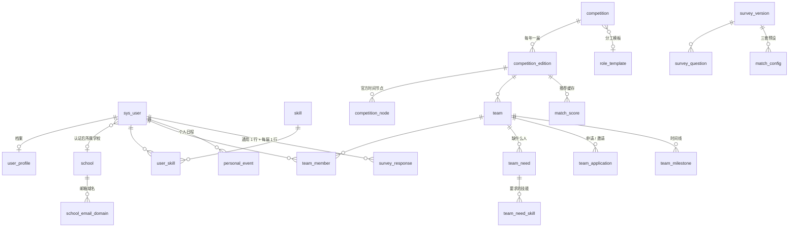

# 数据库设计

- 建表：[V1__schema.sql](../backend/src/main/resources/db/migration/V1__schema.sql)（41 张表，MySQL 8.0）
- 初始数据：[V2__seed.sql](../backend/src/main/resources/db/migration/V2__seed.sql)（技能字典、分工模板、示例比赛、问卷 v2 题目和匹配配置）
- 之后的改动：同一个目录里的 V3、V4……，后端启动时由 Flyway 自动执行，见下面"迁移"一节
- 几条关键约束在临时的 MySQL 8.0.45 实例上逐条测过（见文末）。

## 模块总览

| 模块 | 表 | 一期 / 二期 |
|---|---|---|
| 用户与认证 | `sys_user` 账号、`user_profile` 档案、`school` 学校、`school_email_domain` 邮箱域名、`email_code` 验证码、`verification_request` 认证申请 | 一期 |
| | `login_store` 登录状态、`user_privacy` 隐私设置（个人资料页上的履历给谁看） | 二期 |
| 技能与履历 | `skill` 技能字典、`user_skill` 个人技能、`user_experience` 参赛履历 | 一期 |
| 比赛库 | `competition` 比赛、`competition_edition` 届次、`competition_node` 官方节点、`competition_follow` 关注、`role_template` / `role_template_item` 分工模板 | 一期 |
| 比赛数据来源 | `crawl_source` 爬虫的抓取来源、`crawl_record` 抓到的通知和抽取结果、`school_competition_recognition` / `recognition_confirm` 各校加分认定 | 二期 |
| 队伍 | `team`、`team_member`、`team_need` 招募需求、`team_need_skill` 需求技能、`team_application` 申请和邀请、`team_milestone` 里程碑 | 一期 |
| | `team_task` 里程碑下的分工待办；`advisor_topic` 老师课题（不做了，表留着没用） | 二期 |
| 个人日程 | `personal_event` | 一期 |
| 问卷与匹配 | `survey_version`、`survey_question`、`survey_response`、`match_config`、`match_score` | 一期 |
| | `batch_match_run` 截止前批量撮合 | 二期 |
| 消息 | `notification` 站内信、`reminder_sent` 已发提醒 | 一期 |
| 互评与信用 | `peer_review_round`、`peer_review`、`user_credit`、`report` 举报 | 二期 |

二期的表也一起建好了，免得以后改结构；一期的代码先不用它们。

## 迁移（Flyway）

建表和改表都写成编号的迁移文件，放在 [db/migration](../backend/src/main/resources/db/migration/)，后端启动时由 Flyway 按编号执行还没执行过的，执行到哪一步记在 `flyway_schema_history` 表。这个方案来自队友的压缩包（他们在 v1.0.0 之前的代码上加的），搬过来时按现在的版本重新整理了：

| 文件 | 内容 |
|---|---|
| V1__schema.sql | 现在完整的建表语句 |
| V2__seed.sql | 初始数据 |
| V3__upgrade_old_databases.sql | 旧库补齐：以前要手工跑的 5 个升级脚本（爬虫、日历订阅、登录保持、邮件提醒、隐私设置）合成一个，每一步先查 information_schema，缺了才补。MySQL 8.0 没有 `ADD COLUMN IF NOT EXISTS`，所以用 `PREPARE` 执行，不需要时执行 `DO 0` |
| V4__competition_official_urls.sql | 种子比赛的官网地址（队友整理的），只补空着的 |

两种库：

- **全新的库**：连接串带 `createDatabaseIfNotExist=true`，驱动先建库，Flyway 从 V1 执行到最后。V3 在这种库上每一步都跳过。
- **以前手工导入 schema.sql 建的库**：没有迁移记录，`baseline-on-migrate` 把它记成"已经到 V2"（`baseline-version: 2`），接着从 V3 往后执行。不管当初跑过哪几个升级脚本，V3 补完都和全新的库一样。

接口测试 [migrate.py](../tests/e2e/migrate.py) 把 v1.0.0、v2.0.0、v2.1.0、v2.2.0 各个标签里的建表脚本、初始数据、演示数据导进去，再加一个"v1.0.0 跑过一部分升级脚本"的库，分别用新后端启动，比较字段、索引、外键和全新建的库是否完全一致、数据有没有丢。

注意：

- 已经合并的迁移文件不能再改，否则跑过它的库启动时校验和对不上。要改就再加一个文件。
- MySQL 的 DDL 不在事务里，迁移执行到一半出错时 Flyway 会把这一条记成失败，下次启动会拒绝继续。修好原因后删掉 `flyway_schema_history` 里那条失败的记录再启动。V3 可以重复执行，删掉它的记录重启就会重新补一遍（`login_store`、`user_privacy` 被误删时也是这么补回来）。这要靠配置里的 `out-of-order: true`：默认情况下 V4 已经执行过、V3 却没有，Flyway 会拒绝启动；打开以后没执行过的 V3 会排在后面补执行。

## 核心关系

## 关键设计（答辩时可以讲的点）

### 1. 比赛和届次分开存

比赛每年都办，名称、级别、分工模板是长期不变的；日期、人数上限、是否限同校，每年都可能变。所以拆成 `competition` 和 `competition_edition` 两张表，队伍、问卷的比赛级部分、推荐结果都挂在**届次**上。

### 2. "同一届比赛一个人只能在一支队里"由数据库保证

`team_member` 加了一个生成列 `active_key`：在队时值为 1，退队后值为 NULL。唯一索引建在 `(edition_id, user_id, active_key)` 上。MySQL 的唯一索引不限制 NULL，所以：

- 退队的历史记录可以保留，也能计入履历；
- 同一届里"正在队里"的记录只能有一条，并发情况下也不会被绕过。

`team_application` 用同样的办法，保证同一支队和同一个人之间，同时只有一条待处理的申请或邀请。

> 建队时，队长本人也要写进 `team_member`（`is_captain = 1`），这一步由业务代码负责。

### 3. 问卷"问什么"和"怎么打分"分两张表

- `survey_question` 只存题目、选项和题型参数，前端按它渲染问卷。
- `match_config` 存权重、相容矩阵、一票否决规则和承诺系数，后端按它打分，一行一套预设（默认、短期集中型、长周期型）。

改题目、调权重都只需要改数据，不用改代码，也不用重新部署。这个做法参考了 date-match 的匹配配置。

答案存在 `survey_response.answers` 这个 JSON 字段里。通用部分每人一行（`edition_id` 为空），比赛级部分每届一行。生成列 `edition_key` 把空值换成 0，唯一索引才能管住"通用部分只有一行"。

### 4. 日历是查出来的，不是存出来的

日历里的四个图层分别来自：

| 图层 | 来源 |
|---|---|
| 比赛官方 | 关注的、或者已经参加的届次的 `competition_node` |
| 各个队伍 | 所在队伍的 `team_milestone` |
| 个人 | `personal_event` |

查询时把这几类合并起来返回，不另外存一份"日历表"。队长改了里程碑，所有队员的日历自动跟着变。图层的开关状态存在浏览器本地，不进数据库。

撞期检测只看带 `busy = 1` 的记录（比如 72 小时赛的比赛时段），以及个人日程里默认 `busy = 1` 的事。

### 5. 时间字段沿用简程的模型

`competition_node`、`team_milestone`、`personal_event` 三张表的时间字段一样：

| 字段 | 含义 |
|---|---|
| `start_at` / `end_at` | 确定的开始、结束时间 |
| `all_day` | 全天事件 |
| `start_latest_at` | 开始时间说不准时，最晚可能的开始时间 |
| `end_mode = RANGE` + `end_latest_at` | 结束在一个区间里，比如"成绩预计 11 月中下旬公布" |
| `end_mode = OPEN` | 还没有结束时间 |

个人日程另外有重复规则（每天 / 工作日 / 每周几），也和简程一致。

### 6. 时段用位图存

问卷 G4 的可用时段、队伍的例会时段，都用一个整数的二进制位表示：第 `day × 3 + seg` 位，`day` 0 是周一，`seg` 0/1/2 是上午/下午/晚上，一共 21 位。

算两个人的时段重合度，只需要一次按位与，再数 1 的个数（Java 里是 `Integer.bitCount(a & b)`）。

### 7. 推荐结果做缓存

`match_score` 存每对"学生–队伍"（以及"学生–学生"）的分数、承诺系数和推荐理由（`breakdown`）。答案、队员或招募需求有变化时，只重算受影响的那几行。

"人找队"和"队找人"用的是同一批记录，只是按不同的列排序，两个方向各有一个索引。

### 8. 并发入队：加锁顺序和一次真实的死锁

"接受入队申请"这个事务里，要做这几件事：
1. 写入队员表
2. 把申请标记为已通过
3. 作废这个人在这一届里的其他申请
4. 人满了，再作废发给这支队的其他申请

有两种并发情况要防：

| 情况 | 怎么防 |
|---|---|
| 只剩一个名额，队长同时同意两个申请 | 先 `SELECT … FOR UPDATE` 锁住队伍那一行，拿到锁后再检查人数 |
| 同一个人同时申请了两支队，两个队长同时同意 | 唯一索引能保证只进一支队；但两个事务各锁一支队、又去改对方队伍里的申请，会**死锁** |

第二种情况的解决办法是：所有入队事务统一按 **先锁人、再锁队伍** 的顺序加锁，这样同一个人的入队操作会排队执行。

一开始锁的是 `sys_user` 那一行，结果并发测试里"抢名额"的场景反而出现了死锁。`SHOW ENGINE INNODB STATUS` 显示：把申请改成"作废"时，因为 `status` 字段在外键 `user_id` 所依赖的索引里，InnoDB 会重新检查外键，对 `sys_user` 加共享锁，于是和我们自己加的排他锁互相等待。

最后改成锁 `user_profile` 那一行：每个用户都有这一行，而且没有任何外键引用它，外键检查不会碰到。改完后，每轮 2 个场景、共 5 轮的并发测试全部通过，死锁 0 次。

另外，万一还有没预料到的锁冲突，统一返回 409"有人同时在操作，请刷新后重试"，不会再出现 500。

**后来又发现一种：队伍还剩两个名额，队长同时同意两个申请。** 两个人都进了队（3/3），队伍却还显示"招募中"，队长接着还能同意第四个人，超员了。原因是 MySQL 默认的隔离级别"可重复读"：事务里第一次普通查询时拍一张快照，之后的普通查询一直读这张快照。第二个事务的快照是在等队伍锁之前拍的，等第一个事务提交、拿到锁以后数人数，看到的还是快照里的 1 + 自己 = 2，于是判断"没满"。`FOR UPDATE` 这种加锁读会读最新数据，但数人数、查申请这些用的是普通查询。

办法是把整个后端的隔离级别改成**读已提交**（`application.yml` 里 `spring.datasource.hikari.transaction-isolation`）：每次普通查询都读当时已经提交的数据，等到锁以后再查就是新的。大多数数据库（PostgreSQL、Oracle、SQL Server）默认就是读已提交；MySQL 8 默认的行格式 binlog 也支持。并发测试 [team_race.py](../tests/e2e/team_race.py) 每轮测三种情况（只剩一个名额、一人两队、剩两个名额同时同意），改之前第三种 5 轮全错，改之后全部通过。

各校加分认定（`school_competition_recognition`）也是"先锁人、再按 id 从小到大锁认定"，而且锁人是事务里的第一句，这样同一个人同时点两条"确认"，后一个请求一定能看到前一个的结果，不会算两票。

### 9. 验证码不存明文

`email_code` 只存 SHA-256 摘要，最多试 5 次。以后上了 Redis，可以直接改成存 Redis。

### 10. 登录状态存数据库

登录用的 Sa-Token 默认把登录状态放在后端内存里，后端一重启，所有人都要重新登录。常见做法是放进 Redis，但那样每个队友都得多装一个服务。现在的做法：

- 平时照旧读写内存，每个请求校验登录不多查数据库；
- 登录、退出、停用账号这些改动发生时，同时写一份到 `login_store`（键、值、过期时间；账号会话按 JSON 存）；
- 后端启动时把没过期的读回内存，过期的顺手删掉，之后每天清一次。

写库不跟着业务事务走，内存改了库里就马上改，两边始终一致。旧库没有这张表时退回纯内存，日志里提示跑升级脚本。

`login_store` 里有登录凭证，拿到就能登录别人的账号，和密码哈希一样不要外传。

## 约定

- 表名、字段名用小写下划线；主键都叫 `id`，用 `BIGINT` 自增。
- 状态类字段用 `VARCHAR` 加注释列出取值，不用 MySQL 的 `ENUM`，以后加状态不用改表结构，也方便映射成 Java 枚举。
- 主要业务表有 `deleted` 字段做逻辑删除，配合 MyBatis-Plus 的 `@TableLogic`。
- 加了外键约束。高并发的互联网项目常常不用外键、改在代码里保证，但这个项目数据量小，用外键能直接挡住脏数据，答辩时也好讲清楚表之间的关系。
- 字符集 `utf8mb4`，排序规则 `utf8mb4_0900_ai_ci`。

## 已经验证过的约束

在临时 MySQL 实例里逐条测过：

| 测试 | 结果 |
|---|---|
| 同一届比赛，一个人加入第二支队 | 被唯一索引拦下 ✅ |
| 退队之后再加入别的队 | 成功 ✅ |
| 同一支队对同一个人发第二条待处理的申请或邀请 | 被拦下 ✅ |
| 通用问卷写第二行 | 被拦下 ✅ |
| 同一个人填不同届的比赛级问卷 | 成功 ✅ |
| 技能等级填 4 | 被 CHECK 约束拦下 ✅ |
| 答案字段写入不合法的 JSON | 被拦下 ✅ |
| 默认配置里每个维度的题目权重之和 | 都是 1.00 ✅ |
