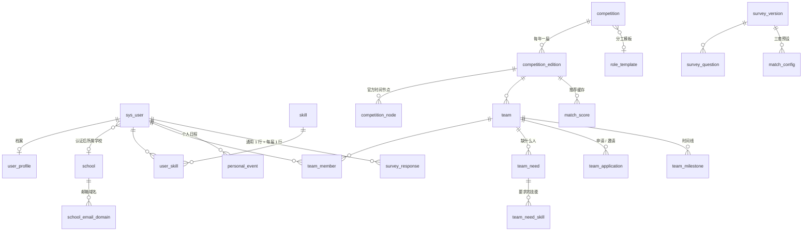

# 数据库设计

- 建表脚本：[sql/schema.sql](../sql/schema.sql)（39 张表，MySQL 8.0）
- 初始数据：[sql/seed.sql](../sql/seed.sql)（技能字典、分工模板、示例比赛、问卷 v2 题目和匹配配置）
- 两个脚本都在一个临时的 MySQL 8.0.45 实例上跑通过，几条关键约束也逐条测过（见文末）。

## 模块总览

| 模块 | 表 | 一期 / 二期 |
|---|---|---|
| 用户与认证 | `sys_user` 账号、`user_profile` 档案、`school` 学校、`school_email_domain` 邮箱域名、`email_code` 验证码、`verification_request` 认证申请 | 一期 |
| 技能与履历 | `skill` 技能字典、`user_skill` 个人技能、`user_experience` 参赛履历 | 一期 |
| 比赛库 | `competition` 比赛、`competition_edition` 届次、`competition_node` 官方节点、`competition_follow` 关注、`role_template` / `role_template_item` 分工模板 | 一期 |
| 比赛数据来源 | `crawl_record` 爬虫记录、`school_competition_recognition` / `recognition_confirm` 各校加分认定 | 二期 |
| 队伍 | `team`、`team_member`、`team_need` 招募需求、`team_need_skill` 需求技能、`team_application` 申请和邀请、`team_milestone` 里程碑 | 一期 |
| | `team_task` 里程碑下的分工待办、`advisor_topic` 老师课题 | 二期 |
| 个人日程 | `personal_event` | 一期 |
| 问卷与匹配 | `survey_version`、`survey_question`、`survey_response`、`match_config`、`match_score` | 一期 |
| | `batch_match_run` 截止前批量撮合 | 二期 |
| 消息 | `notification` 站内信、`reminder_sent` 已发提醒 | 一期 |
| 互评与信用 | `peer_review_round`、`peer_review`、`user_credit`、`report` 举报 | 二期 |

二期的表也一起建好了，免得以后改结构；一期的代码先不用它们。

## 核心关系

## 关键设计（答辩时可以讲的点）

### 1. 比赛和届次分开存

比赛每年都办，名称、级别、分工模板是长期不变的；日期、人数上限、是否限同校，每年都可能变。所以拆成 `competition` 和 `competition_edition` 两张表，队伍、问卷的比赛级部分、推荐结果都挂在**届次**上。

### 2. "同一届比赛一个人只能在一支队里"由数据库保证

`team_member` 加了一个生成列 `active_key`：在队时值为 1，退队后值为 NULL。唯一索引建在 `(edition_id, user_id, active_key)` 上。MySQL 的唯一索引不限制 NULL，所以：

- 退队的历史记录可以保留，也能计入履历；
- 同一届里"正在队里"的记录只能有一条，并发情况下也不会被绕过。

`team_application` 用同样的办法，保证同一支队和同一个人之间，同时只有一条待处理的申请或邀请。

> 建队时，队长本人也要写进 `team_member`（`is_captain = 1`），这一步由业务代码负责。

### 3. 问卷"问什么"和"怎么打分"分两张表

- `survey_question` 只存题目、选项和题型参数，前端按它渲染问卷。
- `match_config` 存权重、相容矩阵、一票否决规则和承诺系数，后端按它打分，一行一套预设（默认、短期集中型、长周期型）。

改题目、调权重都只需要改数据，不用改代码，也不用重新部署。这个做法参考了 date-match 的匹配配置。

答案存在 `survey_response.answers` 这个 JSON 字段里。通用部分每人一行（`edition_id` 为空），比赛级部分每届一行。生成列 `edition_key` 把空值换成 0，唯一索引才能管住"通用部分只有一行"。

### 4. 日历是查出来的，不是存出来的

日历里的四个图层分别来自：

| 图层 | 来源 |
|---|---|
| 比赛官方 | 关注的、或者已经参加的届次的 `competition_node` |
| 各个队伍 | 所在队伍的 `team_milestone` |
| 个人 | `personal_event` |

查询时把这几类合并起来返回，不另外存一份"日历表"。队长改了里程碑，所有队员的日历自动跟着变。图层的开关状态存在浏览器本地，不进数据库。

撞期检测只看带 `busy = 1` 的记录（比如 72 小时赛的比赛时段），以及个人日程里默认 `busy = 1` 的事。

### 5. 时间字段沿用简程的模型

`competition_node`、`team_milestone`、`personal_event` 三张表的时间字段一样：

| 字段 | 含义 |
|---|---|
| `start_at` / `end_at` | 确定的开始、结束时间 |
| `all_day` | 全天事件 |
| `start_latest_at` | 开始时间说不准时，最晚可能的开始时间 |
| `end_mode = RANGE` + `end_latest_at` | 结束在一个区间里，比如"成绩预计 11 月中下旬公布" |
| `end_mode = OPEN` | 还没有结束时间 |

个人日程另外有重复规则（每天 / 工作日 / 每周几），也和简程一致。

### 6. 时段用位图存

问卷 G4 的可用时段、队伍的例会时段，都用一个整数的二进制位表示：第 `day × 3 + seg` 位，`day` 0 是周一，`seg` 0/1/2 是上午/下午/晚上，一共 21 位。

算两个人的时段重合度，只需要一次按位与，再数 1 的个数（Java 里是 `Integer.bitCount(a & b)`）。

### 7. 推荐结果做缓存

`match_score` 存每对"学生–队伍"（以及"学生–学生"）的分数、承诺系数和推荐理由（`breakdown`）。答案、队员或招募需求有变化时，只重算受影响的那几行。

"人找队"和"队找人"用的是同一批记录，只是按不同的列排序，两个方向各有一个索引。

### 8. 验证码不存明文

`email_code` 只存 SHA-256 摘要，最多试 5 次。以后上了 Redis，可以直接改成存 Redis。

## 约定

- 表名、字段名用小写下划线；主键都叫 `id`，用 `BIGINT` 自增。
- 状态类字段用 `VARCHAR` 加注释列出取值，不用 MySQL 的 `ENUM`，以后加状态不用改表结构，也方便映射成 Java 枚举。
- 主要业务表有 `deleted` 字段做逻辑删除，配合 MyBatis-Plus 的 `@TableLogic`。
- 加了外键约束。高并发的互联网项目常常不用外键、改在代码里保证，但这个项目数据量小，用外键能直接挡住脏数据，答辩时也好讲清楚表之间的关系。
- 字符集 `utf8mb4`，排序规则 `utf8mb4_0900_ai_ci`。

## 已经验证过的约束

在临时 MySQL 实例里逐条测过：

| 测试 | 结果 |
|---|---|
| 同一届比赛，一个人加入第二支队 | 被唯一索引拦下 ✅ |
| 退队之后再加入别的队 | 成功 ✅ |
| 同一支队对同一个人发第二条待处理的申请或邀请 | 被拦下 ✅ |
| 通用问卷写第二行 | 被拦下 ✅ |
| 同一个人填不同届的比赛级问卷 | 成功 ✅ |
| 技能等级填 4 | 被 CHECK 约束拦下 ✅ |
| 答案字段写入不合法的 JSON | 被拦下 ✅ |
| 默认配置里每个维度的题目权重之和 | 都是 1.00 ✅ |
