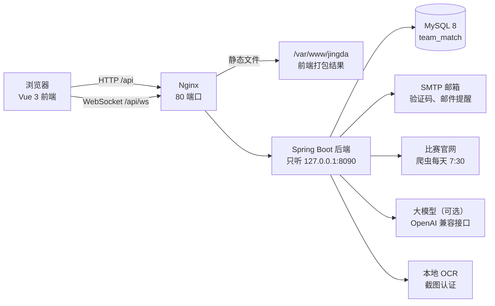

# 项目交接

更新于 2026-10-28。写给接手维护「竞搭」的人。看完这份，应该能把项目跑起来，知道每块代码在哪，改代码时不踩已知的坑，也知道线上怎么部署、出了问题怎么恢复。

功能怎么用见 [功能介绍](功能介绍.md)，做到哪了见 [项目进度](项目进度.md)，安装和每个功能的细节见 [README](../README.md)，协作流程见 [一起开发](../CONTRIBUTING.md)。

## 1. 现状一览

| 项目 | 内容 |
|---|---|
| 是什么 | 大学生竞赛组队匹配平台：身份认证 → 问卷画像 → 匹配推荐 → 申请组队 → 日程协作 → 赛后互评，互评得出的信用分再乘进推荐分 |
| 仓库 | <https://github.com/zonglingzhang0-a11y/Competition-Matching-Platform>（公开） |
| 分支 | `main` 是发布版（最新 v2.3.0）；`dev` 是日常开发，线上跑的就是它 |
| 线上 | <http://47.111.123.178>，阿里云 Ubuntu 22.04（2 核 4G），只有 HTTP |
| 技术栈 | 后端 Spring Boot 4 + MyBatis-Plus + Sa-Token（Java 21）；前端 Vue 3 + TypeScript + Vite + Pinia + Element Plus；MySQL 8 + Flyway |
| 规模 | 约 4.5 万行；后端 23 个包；数据库 11 个迁移；接口测试 26 套 861 项，后端单元测试 183 个 |

小组分工（有问题先找对应的人）：

| 成员 | 负责 |
|---|---|
| 何郝好 | 队伍招募（创建队伍、关联比赛）、申请和邀请 |
| 田展驰 | 个人信息填写、赛库（赛事信息）、数据库设计 |
| 张宗令 | 匹配和推荐、消息和通知、前端页面 |
| 何金豪 | 履历互评、个人日程 |

## 2. 架构

一次请求的路线：前端 `api/*.ts` → `api/http.ts`（带上登录令牌、统一报错）→ 后端 Controller → Service → Mapper（MyBatis-Plus）→ MySQL。

- 登录校验在 `config/WebConfig` 的拦截器里（Sa-Token），角色在 `user/StpInterfaceImpl`。
- 接口统一返回 `common/Result`，业务错误抛 `common/BizException`（带 HTTP 状态码和中文提示），由 `common/GlobalExceptionHandler` 转成响应。

## 3. 代码地图

### 后端 `backend/src/main/java/com/teammatch/`

| 包 | 管什么 | 对口 |
|---|---|---|
| `auth` | 注册、登录、退出、忘记密码；登录失败锁定（`LoginThrottle`）；登录状态存库，后端重启不掉线 | |
| `code` `mail` | 邮箱验证码的生成、校验和发送上限（`CodeSendLimiter`）；发信（log 模式打印到控制台，smtp 模式真发） | |
| `user` | 账号；`app.admin-emails` 里的邮箱注册即为管理员；管理员的账号管理 | |
| `school` `verify` | 学校和邮箱后缀；教育邮箱认证、截图认证（OCR 认字后比对）、管理员审核 | 田展驰 |
| `profile` `radar` | 个人档案、技能、履历、个人资料页（按关系分级可见）；能力雷达 | 田展驰 |
| `competition` `recognition` `crawler` | 比赛库和届次；各校加分认定；爬虫抓通知、大模型补抽、比赛页「AI 帮我整理」 | 田展驰 |
| `team` | 队伍、招募需求、申请和邀请、入队的并发控制 | 何郝好 |
| `survey` | 问卷题目和答案校验 | 张宗令 |
| `match` | 匹配引擎（`MatchEngine` + `Scorers`）、匹配配置、推荐、批量撮合（`GroupPlanner`）、申请时记录推荐分 | 张宗令 |
| `notification` | 站内信、WebSocket 推送（`PushHandler`）、邮件汇总（`NotificationMailJob`） | 张宗令 |
| `home` | 主页的数据和自定义布局 | 张宗令 |
| `calendar` | 日历三个图层、个人日程、撞期、队伍里程碑、订阅链接（iCalendar）、截止提醒 | 何金豪 |
| `review` | 赛后互评、信用分（`CreditCalculator`）、举报、暂停推荐 | 何金豪 |
| `dashboard` | 管理后台数据看板：风险图、漏斗、推荐准不准、运营 | |
| `ai` `llm` | AI 能力分析和招募建议；大模型连接（`LlmClient`，一次只发一个请求） | |
| `common` `config` | 统一返回、异常、访问者 IP（`ClientIp`）、配置类、拦截器 | |

### 前端 `frontend/src/`

| 目录 | 内容 |
|---|---|
| `views/` | 页面，路由在 `router/index.ts`；`views/admin/` 是管理后台 |
| `components/` | 组件；`components/home/` 是主页的各个面板，`components/admin/` 是看板图表 |
| `api/` | 按模块封装的接口；`http.ts` 是统一的 axios 实例，慢接口用 `postSlow` |
| `stores/` | Pinia：`user`（登录状态）、`notification`（未读数和推送）、`admin`、`userPage` |
| `types/api.ts` | 接口的类型定义 |

### 其他目录

| 目录 | 内容 |
|---|---|
| `backend/src/main/resources/db/migration/` | Flyway 迁移，`V1__schema.sql` 建表、`V2__seed.sql` 初始数据，之后每次改表加一个 |
| `sql/` | 演示数据 `demo.sql` 等，不是建表脚本 |
| `tests/e2e/` | 接口测试；`sites/` 是测试用的假官网、假大模型 |
| `deploy/` | 部署脚本、systemd 服务、Nginx 配置、备份 |
| `scripts/` | `public-demo.ps1`（Cloudflare 临时隧道）、`demo-video/`（录演示视频） |
| `.github/workflows/ci.yml` | CI：后端测试、接口测试、前端检查 |

## 4. 本地跑起来

要 JDK 21、Node.js 24（`^22.18` 或 `>=24.12`）、MySQL 8.0.16 以上。详细步骤和常见问题见 README 的"第一次运行"。

1. 把 `backend/src/main/resources/application-local.example.yml` 复制成同目录的 `application-local.yml`，填本机 MySQL 的密码。这个文件被 git 忽略，也不会打进 jar。
2. 后端：在 `backend` 目录运行 `./mvnw spring-boot:run`。第一次启动时 Flyway 会自动建库、建表、填初始数据。
3. 前端：在 `frontend` 目录运行 `npm install`，再运行 `npm run dev`，打开 <http://localhost:5173>。
4. 演示数据：后端启动过一次之后，导入 `sql/demo.sql`（命令见 README 的"演示数据"），演示账号和密码写在这个文件开头。
5. 本机默认不真发邮件，注册和认证的验证码打印在后端控制台里。

## 5. 配置项

都在 `backend/src/main/resources/application.yml` 的 `app` 下面，每项都有注释。密码、授权码、密钥只放在 `application-local.yml`（本机）或服务器的 `/opt/jingda/` 里，**不要提交进仓库**。

| 配置 | 默认 | 什么时候改 |
|---|---|---|
| `app.mail.mode`、`app.mail.from`，加上 `spring.mail.*` | `log` | 要真发邮件时改成 `smtp`；服务器上写在 `/opt/jingda/mail.yml`，用 `deploy/set-mail.sh` 生成 |
| `app.code.ip-per-hour` / `ip-per-day` / `total-per-day` | 30 / 100 / 300 | 全班在同一个校园网里一起注册前，把 `ip-per-hour` 调大（每人要发注册和学校认证两封） |
| `app.admin-emails` | 空 | 用这些邮箱注册的账号自动成为管理员 |
| `app.notify-mail.site-url` | `http://localhost:5173` | 部署后改成真实网址，否则邮件里的链接打不开 |
| `app.llm.*` | 关 | 接大模型（本机或云端，OpenAI 兼容）；服务器上用 `deploy/set-llm.sh` |
| `app.ai.enabled` | `false` | 允许把档案发给大模型做能力分析；关着时用本地规则 |
| `app.crawler.*` | 开，每天 7:30 | 改抓取时间、间隔、每次最多打开几篇 |
| `app.screenshot.*` | `uploads`、OCR 开、每人每天 3 次 | 改原图目录、关掉 OCR 预审 |
| `app.recognition.confirms-needed` | 2 | 加分认定要几位同校同学确认才显示 |
| `app.push.allowed-origin-patterns` | 空 | 用别的域名访问（比如临时隧道）时放行 WebSocket |

## 6. 数据库

- 表结构和关键设计见 [数据库设计](数据库设计.md)。
- **只加新迁移，不改已经发布的迁移**：Flyway 会校验每个迁移文件的校验和，改了旧文件，已有的库启动会报错。新迁移命名 `V{下一个编号}__说明.sql`，最好写成能重复执行的。
- **迁移编号会撞**：两个人在不同分支上各加一个迁移，编号可能相同。合并前先看 `dev` 上最新的编号，`V10`、`V11` 就是合并队友代码时重新编的号。
- **备份**：线上每天凌晨 4 点自动备份到 `/var/backups/jingda`，留 7 天；`systemctl start jingda-backup` 马上备份一次。恢复命令写在 `deploy/jingda-backup.sh` 开头，恢复前先停后端。
- **时间字段只到秒，而且会四舍五入**：Java 里的"现在"带小数秒，存进 DATETIME 会进位成下一秒。写入"现在"后马上要拿来比较的地方，先截到整秒，解除暂停、AI 分析时间都踩过这个坑。

## 7. 改代码前要知道的事

| 地方 | 要知道的 | 改了要跑 |
|---|---|---|
| 入队 | 同意申请时用 `SELECT … FOR UPDATE` 锁住队伍那一行，再检查人数；同一届一人只能在一支队，由唯一约束兜底；事务隔离级别是读已提交（数据库设计第 8 节） | `team_race` |
| 提交后再处理 | 推送、记录推荐分都在业务事务提交之后做（`@TransactionalEventListener(AFTER_COMMIT)`），不要在事务里推送 | `push`、`m6` |
| 大模型 | 一次只发一个请求，排队超过 `wait-ms` 就提示"正忙"；所有 AI 输出都要带原文依据，对不上的丢掉，失败就退回规则并在页面上标明。加新的 AI 功能照这个做 | `llm`、`radar_ai` |
| 实时推送 | 建连接用一次性票，后端只接受同域名页面的连接；断线自动重连，连不上时每分钟查一次 | `push` |
| 验证码限量 | 按 IP 计数靠 Nginx 设的 `X-Real-IP`，而且只在请求来自本机时才信。改 Nginx 配置别删这一行，不然所有人都算同一个 IP | `m1`、`reset_password` |
| OCR | 本地库按打包时的系统选，部署用的 jar 必须在 Linux 上打（`deploy.sh` 就是在服务器上打包的） | `ocr` |
| 隐私 | 个人日程标题只给本人看；个人资料页按关系分级显示；发给大模型的资料里去掉邮箱和微信 | `profile`、`m5` |
| 主页面板 | 面板列表在前端 `components/home/layout.ts` 和后端 `home/HomeLayoutService` 两处，加面板要一起改 | `m4` |
| 配置文件 | `application-local.yml` 不打进 jar；服务器的配置在 `/opt/jingda/`，别用本机的覆盖 | |

## 8. 测试和 CI

- 后端单元测试：在 `backend` 目录运行 `./mvnw test`，183 个。
- 接口测试：`tests/e2e/run.py`，26 套 861 项。需要一个能随便删库的 MySQL，用 `E2E_DB_*` 环境变量指定；测试库不许叫 `team_match`，防止误删平时用的库。`python run.py m1 team_race` 只跑指定的几套。
- 前端：`npm run type-check`、`npm run build`、`npm test`。
- CI：推 `dev`、`main` 和提 PR 时，GitHub Actions 自动跑后端测试、接口测试（MySQL 容器）和前端检查；接口测试失败时，日志可以在这次运行的 `e2e-logs` 里下载。
- 规则：新接口写接口测试并加进 `run.py` 的 `SUITES`；纯计算的逻辑写单元测试。

## 9. 部署和运维

服务器上各部分在哪，见 [deploy/README.md](../deploy/README.md)。最常用的：

| 要做的事 | 怎么做 |
|---|---|
| 拿到服务器权限 | 自己生成密钥（`ssh-keygen -t ed25519`），把公钥发给管服务器的人，加到 `/root/.ssh/authorized_keys`；收回权限就删掉那一行 |
| 部署 | 本机切到要发布的分支、拉到最新、确认没有没提交的改动，然后在 Git Bash 里运行 `KEY=~/.ssh/你的私钥 bash deploy/deploy.sh` |
| 看后端状态和日志 | `systemctl status jingda`；`journalctl -u jingda -f` |
| 重启后端 | `systemctl restart jingda` |
| 马上备份 | `systemctl start jingda-backup` |
| 配发信邮箱、大模型 | `bash deploy/set-mail.sh`、`bash deploy/set-llm.sh`（密钥在自己终端里输入） |
| 换一台新服务器 | `SERVER=root@新IP bash deploy/deploy.sh --setup`。注意 `server-setup.sh` 现在在空库上会失败（见下一节），先修 |

部署前建议先手动备份一次：每次部署后端重启时，Flyway 都可能改表结构。

## 10. 已知问题和待办

- 没有 HTTPS，登录密码和凭证是明文传的。绑域名要先 ICP 备案，或者给 IP 配证书。
- `deploy/server-setup.sh` 在全新的服务器上会失败：它还在导入 v2.3.0 已经删掉的 `sql/schema.sql`、`seed.sql`。应该只建空库，让后端第一次启动时由 Flyway 建表，再导入 `demo.sql`。
- 手机订阅日历还没用真手机试过。
- 爬虫的分类偶尔放错；和学生无关的通知也会被整理，需要让管理员能挑选通知。
- QQ 邮箱每天的发信量有限，人多了要换企业邮箱或云邮件推送。
- 服务器 Nginx 没关 `server_tokens`，响应头里能看到 Nginx 版本号（小事）。

## 11. 协作约定

- 在 `dev` 上开发，或从 `dev` 拉功能分支、提 PR 合回 `dev`；发版时把 `dev` 合进 `main`，打 `vX.Y.Z` 标签。
- 提交信息用中文，写清楚改了什么、为什么这样改，参考 `git log` 里已有的写法。
- 发现问题在 GitHub 提 Issue，格式见项目进度的"怎么反馈"。

## 12. 交接清单

- [ ] GitHub 仓库的写权限（仓库所有者是 zonglingzhang0-a11y）
- [ ] 服务器 SSH 权限：公钥交给管服务器的人
- [ ] 阿里云账号是谁的、服务器什么时候到期、谁负责续费：[待填]
- [ ] 发信用的 QQ 邮箱是哪个、授权码谁能重置（授权码只在服务器的 `/opt/jingda/mail.yml` 里）：[待填]
- [ ] 演示账号：密码在 `sql/demo.sql` 开头；线上的管理员密码已经改过，找管服务器的人要
- [ ] 在一台新电脑上照第 4 节走一遍，确认能跑起来
