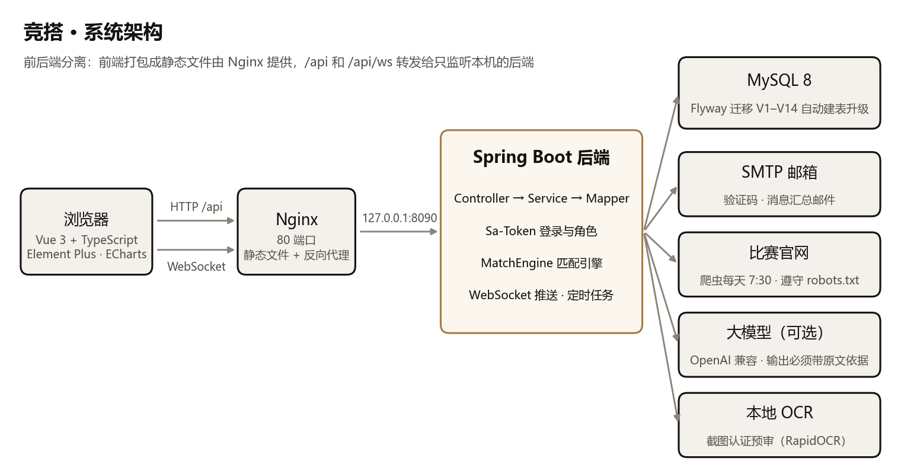

# 竞搭：竞赛组队匹配平台 · 项目说明书

2026 Web 开发技术 · 第八组（何郝好、田展驰、张宗令、何金豪）。更新于 2026-10-30。

这份说明书把项目从"要解决什么问题"讲到"怎么接手维护"，一份讲全；每一部分更细的内容在仓库 `docs/` 下有单独的文档，文中会指出来。

## 1. 项目概况

| 项目 | 内容 |
|---|---|
| 是什么 | 帮大学生找竞赛队友的网站：身份认证 → 问卷画像 → 匹配推荐（带理由）→ 申请和邀请组队 → 日程协作 → 赛后互评，互评得出的信用分再折进推荐 |
| 线上地址 | http://47.111.123.178 （阿里云 Ubuntu 22.04，2 核 4G；只有 HTTP） |
| 代码仓库 | https://github.com/zonglingzhang0-a11y/Competition-Matching-Platform （公开） |
| 分支 | `main` 是发布版（最新 v2.3.0），`dev` 是日常开发，线上跑的是 `dev` |
| 技术栈 | 后端 Spring Boot 4 + MyBatis-Plus + Sa-Token（Java 21）；前端 Vue 3 + TypeScript + Vite + Pinia + Element Plus；MySQL 8 + Flyway |
| 规模 | 约 4.5 万行代码；后端 23 个包；数据库 15 个迁移；接口测试 26 套 861 项检查；后端单元测试 183 个 |
| 开发周期 | 2026-10-08 立项，10-10 开工，两周发了 8 个版本 |

小组分工：

| 成员 | 负责模块 |
|---|---|
| 何郝好（组长） | 队伍招募（创建队伍、关联比赛）、申请和邀请 |
| 田展驰 | 个人信息填写、赛库（赛事信息）、数据库设计 |
| 张宗令 | 匹配和推荐、消息和通知、前端页面 |
| 何金豪 | 履历互评、个人日程 |

## 2. 需求分析

### 2.1 要解决的问题

参加竞赛，最难的往往是找队友：

1. **只能在熟人圈里找。** 找队友靠在 QQ 群、朋友圈里喊一声，看不到对方会什么；队伍缺一个会编程的，不知道去哪找。
2. **比赛信息太散。** 报名时间、组队要求散在各个官网和群里；能不能加综测分，每个学校的认定还不一样。
3. **组上了也不一定靠谱。** 目标不一致（一个想冲国一、一个只想体验）、时间对不上、做到一半人找不到了。

所以目标不是"把厉害的人凑在一起"，而是把"谁会什么、想要什么、什么时候有空"和"哪个队缺什么"都变成结构化的数据，由系统推荐合适的人和队伍，并且讲得出理由。

### 2.2 用户和角色

| 角色 | 能做什么 |
|---|---|
| 学生 | 认证身份、填档案和问卷；看推荐、申请加入队伍；当队长建队、发邀请、处理申请；管日历；赛后互评；标注本校的加分认定 |
| 队长 | 学生在建队后自动成为队长：写招募需求、同意或拒绝申请、邀请推荐的人、管理队伍时间线和分工 |
| 管理员 | 审核身份认证、维护比赛库和学校邮箱后缀、确认爬虫抓到的通知、调整问卷和匹配配置、处理举报、看数据看板 |

### 2.3 功能需求

| 模块 | 需求 |
|---|---|
| 身份认证 | 学校邮箱收验证码直接认证（按邮箱域名认出学校）；没有学校邮箱的传学信网截图，本地 OCR 预审后人工审核；没认证的人能浏览、填问卷，但不能建队和申请 |
| 个人档案 | 专业、年级、技能和熟练度（1–3 级）、参赛履历；技能归成六类能力画成雷达图；个人资料页按关系分级显示 |
| 比赛库 | 比赛和届次分开存；届次有报名时间、人数、是否限同校、官方时间节点；关注比赛；爬虫每天抓官网通知，规则抽字段、大模型可选补抽，管理员核对后才入库；各校加分认定由同校同学标注、多人确认 |
| 队伍招募 | 建队时关联到某个比赛的某一届；写招募需求（缺什么角色、要什么技能）；队伍满员自动停止招募 |
| 申请和邀请 | 学生申请、队长邀请，两个方向都要对方确认；满员后其他待处理的申请和邀请自动失效；同一届一个人只能在一支队 |
| 匹配推荐 | 人找队、队找人两个方向；每条推荐有总分、五个维度加投入保障的六边形、推荐理由和"组队前先聊聊"；一票否决只用于客观事实；批量撮合只给建议 |
| 消息通知 | 站内信；WebSocket 实时推送，断线重连、连不上时轮询；人不在网站上时把没看的消息汇总成邮件；报名截止、比赛开始、队伍节点到期前提醒 |
| 日历 | 比赛官方节点、队伍里程碑、个人日程三个图层叠在一起；撞期标红；一句话添加日程；订阅到手机日历（iCalendar） |
| 互评与信用 | 比赛结束后 7 天匿名互评，交齐或到期统一揭晓；算成信用分折进推荐；两场都被评为经常失联的暂停推荐 30 天，管理员可复核；举报 |
| 管理后台 | 认证审核、比赛库、通知抓取、学校和邮箱后缀、匹配配置（保存前校验和试算）、账号管理、数据看板（风险图、漏斗、推荐准不准、运营） |

### 2.4 非功能需求

- **安全**：密码 BCrypt 加密；验证码只存摘要、限次数、按 IP 和全站限量；登录失败锁定；所有接口按登录状态和角色校验。
- **隐私**：邮箱、手机号、学号谁都看不到；真实姓名和微信 QQ 只给队友；个人日程的标题只给本人看，推荐里只说"有个人安排"；发给大模型的资料去掉联系方式。
- **数据真实**：比赛信息要有官方原文依据；AI 生成的每条内容都要带原文引用，对不上的丢掉，失败就退回规则并在页面上标明。
- **并发正确**：两个申请同时被同意时队伍不能超员，同一届一个人不能进两支队。
- **可维护**：数据库结构用迁移文件管理，老库启动时自动升级；接口测试和单元测试在 CI 里每次提交都跑。

## 3. 总体设计



- 前后端分离：前端打包成静态文件由 Nginx 提供；`/api` 和 `/api/ws`（WebSocket）转发给只监听本机 8090 端口的后端。
- 一次请求的路线：前端 `api/*.ts` → `api/http.ts`（带上登录令牌、统一报错）→ 后端 Controller → Service → Mapper（MyBatis-Plus）→ MySQL。
- 接口统一返回 `common/Result`；业务错误抛 `common/BizException`（带 HTTP 状态码和中文提示），由全局异常处理转成响应。
- 登录用 Sa-Token，登录状态同时写进数据库（`login_store` 表），后端重启用户也不掉线。
- 提交后再处理：推送、记录推荐分这类副作用都在业务事务提交之后执行（`@TransactionalEventListener(AFTER_COMMIT)`），事务回滚就不会发出错误的通知。

### 3.1 代码结构

| 位置 | 内容 |
|---|---|
| `backend/src/main/java/com/teammatch/` | 后端，按业务分包：`auth` `code` `mail` `user` `school` `verify` `profile` `radar` `competition` `recognition` `crawler` `team` `survey` `match` `notification` `home` `calendar` `review` `dashboard` `ai` `llm` `common` `config` 等 |
| `backend/src/main/resources/db/migration/` | Flyway 迁移 V1–V15 |
| `frontend/src/` | 前端：`views/` 页面（`views/admin/` 管理后台）、`components/` 组件、`api/` 接口封装、`stores/` 状态、`types/api.ts` 接口类型 |
| `tests/e2e/` | 接口测试（26 套），`sites/` 是测试用的假官网、假大模型 |
| `deploy/` | 部署脚本、systemd 服务、Nginx 配置、自动备份 |
| `scripts/demo-video/` | 演示视频的录制脚本（真实操作录屏 + 讲解层） |
| `.github/workflows/ci.yml` | CI：后端测试、接口测试（MySQL 容器）、前端检查 |

每个包管什么、对口找谁，见 `docs/项目交接.md` 第 3 节。

## 4. 功能模块和实现要点

### 4.1 身份认证、档案和比赛库（田展驰）

- **教育邮箱认证**：用学校邮箱收一次验证码，就证明本人能收这个邮箱。`SchoolResolver` 把邮箱域名从完整的一层层往上找（`mail.stu.xxx.edu.cn` → `stu.xxx.edu.cn` → `xxx.edu.cn`），找到收录的学校就直接认证成功。已收录湖南 34 所本科高校和全部 985、211 高校（共 146 所），每个域名都查过 MX 记录（真的能收信）和官网（确实是这所学校）。
- **截图认证**：没有学校邮箱的传学信网截图，本地 OCR（RapidOCR）认字后和档案比对，结果给管理员参考；审核完删除原图。截图可以 P，所以 OCR 只减轻审核工作量，不能单独当证据。
- **档案与雷达**：技能字典 70 多项，按类别分组；能力雷达把技能归成编程开发、建模与算法、数据与调研、设计表达、写作答辩、硬件工程六类，没填的轴按专业估一个起点并标"推断"。
- **比赛库**：比赛（每年都办的系列）和届次（具体日期、人数、规则）分开存。比赛库按中南大学现行竞赛清单收录了 130 个比赛，其中 15 个已按官方通知建好届次（见第 9 节）。爬虫每天 7:30 抓各官网通知，遵守 robots.txt、同站间隔 2 秒，规则抽报名时间、人数等字段并记下依据，管理员核对原文后才生成届次。
- **加分认定**：认证过的同学标注本校把某个比赛认定成什么级别、附上学校文件，另外两位同校同学确认后才对外显示；一人一种说法，改了级别确认清零。

### 4.2 队伍招募、申请和邀请（何郝好）

- 建队时关联到某个比赛的某一届，人数上限不超过这届的规定；招募需求写清缺什么角色、几个人、什么技能。
- 学生选对应的需求、写留言申请；队长也可以在"推荐邀请的人"里主动邀请。两个方向都要对方确认。
- **并发控制**：同意申请时先锁人（`user_profile` 行）、再锁队伍（`SELECT … FOR UPDATE`），检查人数后再加入；"同一届一个人只在一支队"由数据库唯一约束兜底。队伍满员后，其他待处理的申请和邀请自动变成"已失效"。接口测试 `team_race` 用多个线程同时同意，验证不会超员。锁的顺序曾经引发过一次真实的死锁，排查过程写在数据库设计第 8 节。

### 4.3 匹配推荐、消息通知和前端（张宗令）

- **匹配引擎**（`match/MatchEngine`，纯 Java，有单元测试）分三步：
  1. 一票否决：暂停推荐的、和已参加的比赛撞期的、不满足比赛规则的、目标差太远的（冲国一 vs 先体验），直接不推荐，并写明原因；
  2. 逐题打分再按五个维度加权（目标与投入、能力与角色、协作风格、时间与节奏、责任与底线），共十种打分方式；
  3. 乘系数：信用分和考试、实习这类约束折成投入保障系数 K（0.6–1.0）；只能线上、队伍却要线下见面的乘 0.7 等。
- 权重和打分方式都存在数据库的匹配配置里，按比赛类型有默认、短期集中、长周期三套预设，管理员在后台改了马上生效。
- **推荐理由**：把"权重 × 得分"最高的两题套模板写成理由；得分最低的维度生成一句"组队前先聊聊"；K 小于 1 的原因单独列一行。
- **消息**：业务提交后用 WebSocket 推送（一次性票建连接、只接受同域名页面的连接），铃铛数字马上变、弹出提示，多个页面已读同步；断线自动重连，连不上就每分钟查一次。十分钟没看的消息汇总成一封邮件。
- **前端**：统一的设计系统（暖灰白底、细线、方角卡片），主页三栏可自定义面板，手机端布局；主页的匹配六边形是手画的 SVG。

### 4.4 履历互评和个人日程（何金豪）

- 队长录入奖项、标记比赛结束后，队员的履历自动记上这场比赛，同时开启 7 天匿名互评；都交了或到期统一揭晓，先交的人不会被针对。
- 日历把比赛节点、队伍里程碑、个人日程叠成三个图层，撞期标红；个人日程可以"说不准"（最晚可能的开始时间）；一句话添加日程（如"11 月 15 日下午 2 点到 5 点 社团换届"）；可以订阅到手机日历。

### 4.5 管理后台

认证审核、学校和邮箱后缀、比赛库管理、通知抓取、匹配配置、加分认定审核、账号管理；数据看板有组队风险图（每一届快截止了还有多少人没进队）、组队漏斗、推荐准不准（推荐分高的申请是不是更容易被同意）和运营面板（积压的申请、待审认证、爬虫健康、举报）。

## 5. 数据库设计

共 40 多张表，按模块分组（详见 `docs/数据库设计.md`）：

| 模块 | 主要的表 |
|---|---|
| 用户与认证 | `sys_user`、`user_profile`、`school`、`school_email_domain`、`email_code`、`verification_request`、`login_store` |
| 技能与履历 | `skill`、`user_skill`、`user_experience` |
| 比赛库 | `competition`、`competition_edition`、`competition_node`、`competition_follow`、`crawl_source`、`crawl_record`、`school_competition_recognition` |
| 队伍 | `team`、`team_member`、`team_need`、`team_application`、`team_milestone`、`team_task` |
| 问卷与匹配 | `survey_version`、`survey_question`、`survey_response`、`match_config` |
| 消息、日程、互评 | `notification`、`personal_event`、`peer_review_round`、`peer_review`、`user_credit`、`report` |

关键设计：比赛和届次分开存；问卷"问什么"和"怎么打分"分两张表；日历是查出来的（三个图层实时合并），不存冗余；时段用位图存；验证码只存 SHA-256 摘要。

**迁移**：建表和改表都写成编号的迁移文件，后端启动时 Flyway 自动执行还没执行过的。已经发布的迁移不能改，要改就加新的。以前手工建的老库会被记成"已到 V2"，再从 V3 补齐，`tests/e2e/migrate.py` 验证老版本的库升级后和新建的库结构完全一致。

| 迁移 | 内容 |
|---|---|
| V1、V2 | 建表、初始数据（技能字典、问卷、匹配配置、5 个种子比赛） |
| V3–V11 | 老库补齐、官网地址、去掉老师角色和批量撮合记录、AI 整理、个人偏好、申请时的匹配分、技能字典扩充、AI 分析 |
| V12 | 湖南 34 所本科高校的邮箱域名 |
| V13 | 985、211 高校 112 所的邮箱域名 |
| V14 | 中南大学竞赛清单里的比赛；比赛级别加上"国际级" |
| V15 | 按中南大学现行 2021 版清单核对比赛库（改名 8 个、新增 35 个），补上从官网核对过的赛制和 15 个届次 |

## 6. 关键算法

**匹配总分**：

```
维度分 = Σ 题内权重 × 题目得分
原始分 = 100 × Σ 维度权重 × 维度分
最终分 = (50 + (原始分 − 50) × 完整度) × K × 其他系数
K = K历史 × K限制（0.6–1.0）；K历史 = 0.6 + 0.4 × 信用分 / 100（新用户记 1.0）
```

完整度是有数据的题占的权重比例：问卷填全了分数不变，什么都没填就是 50 分，避免只填一两题的人凭一题高分排到前面。例：演示数据里林晓对数模冲刺队，五维加权 96.8 分，完整度 1、K = 1，因为有个人日程和比赛期间重叠乘 0.9，得 87 分。

**信用分**：互评六项行为按频率打 0–3 分（从未 / 偶尔 / 有时 / 经常），前三项（失联、不按时交付、敷衍）算两倍分量。一个评分人给出的分 = 100 × (1 − 加权频率 / 加权满分)；本轮得分是各评分人的加权平均（自评不算）。有 3 个及以上评分人时做异常检测：某人在至少 4 项上和其他人的平均差 2 档以上，权重降到 0.5 并标给管理员。

## 7. 测试

| 种类 | 数量 | 怎么跑 |
|---|---|---|
| 后端单元测试 | 183 个 | `backend` 目录 `./mvnw test`；匹配引擎、信用分、截图比对、日程展开等纯计算逻辑 |
| 接口测试 | 26 套、861 项检查 | `tests/e2e/run.py`，需要一个能随便删库的 MySQL（`E2E_DB_*` 环境变量）；每套重建测试库、起真实后端、按用户操作调接口 |
| 前端检查 | 类型检查、打包、单元测试 | `frontend` 目录 `npm run type-check`、`npm run build`、`npm test` |
| CI | 每次推送和 PR | GitHub Actions 跑上面三种，接口测试用 MySQL 8.0 容器；失败时日志在 `e2e-logs` 里下载 |

接口测试覆盖注册登录、认证（含截图 OCR）、比赛库和爬虫（假官网、假大模型）、组队和并发、问卷和推荐、日历、通知推送和邮件、互评、加分认定、管理后台、数据库迁移等。

## 8. 部署和运维

| 部分 | 位置 |
|---|---|
| 后端 | systemd 服务 `jingda`，`/opt/jingda/app.jar`，以 `jingda` 用户运行，只听 `127.0.0.1:8090` |
| 前端 | Nginx 根目录 `/var/www/jingda`，配置 `/etc/nginx/sites-available/jingda` |
| 配置 | `/opt/jingda/application-local.yml`（数据库）、`mail.yml`（发信邮箱授权码）、`llm.yml`（大模型，可选）；都不进仓库 |
| 数据库 | MySQL 8，库 `team_match`；3306 和 8090 不对公网开放 |
| 备份 | 每天凌晨 4 点自动备份到 `/var/backups/jingda`，留 7 天；`systemctl start jingda-backup` 马上备份 |

部署：本机切到要发布的分支、确认没有未提交的改动，在 Git Bash 里运行 `KEY=~/.ssh/私钥 bash deploy/deploy.sh`。脚本把代码传到服务器、在服务器上打包（截图 OCR 的本地库跟操作系统走，必须在 Linux 上打包）、替换前端、重启后端；后端启动时 Flyway 自动升级数据库。部署前建议手动备份一次。

## 9. 数据来源和真实性

| 数据 | 来源 |
|---|---|
| 学校和邮箱域名 | 湖南 34 所本科高校（V12）+ 985、211 高校（V13）。每个域名都查过 MX 记录，并核对官网首页标题；官网反爬的看限定该域名的搜索结果 |
| 比赛库 | V14 先按中南大学 2019 年的两份公开文件收录 95 个；V15 按现行的中大教字〔2021〕107 号附件 1《学科竞赛（含“挑战杯”）获奖加分项目》（“挑战杯”2 项 + 学科竞赛 104 项）逐条核对：8 个改成现在的正式名称，新增 35 个，共 130 个；2021 版没列入的 23 个保留，说明里注明。名称、级别照文件和官网写；是否在全国竞赛排行榜里按《2026 年全国普通高校大学生竞赛排行榜内竞赛项目名单》对照 |
| 赛制和届次 | V15 逐个打开官网和官方通知原文（含高校转发的组委会原文件）核对：长通知先用本地模型抽字段并带原文引用，脚本核对引用在原文里，再人工逐条核对；只有新闻或搜索摘要的信息不写。官网在 robots.txt 里拒绝 AI 的（挑战杯、iGEM、COMAP 等）不用其内容。写明每队人数、并且有报名截止或还有没过去的时间节点的建了 15 个届次，其余把赛制和最近一届的时间写进比赛说明 |
| 加分认定 | 由同校同学标注、附学校文件、多人确认，系统不代填 |
| 演示数据 | `sql/demo.sql` 里的"示例大学"和林晓、陈一舟等账号是虚构的演示数据，只用于本机演示和录视频 |

2021 版清单原文要输验证码才能下载，由用户手动下载后交给我们核对（来源和对照结果写在 V15 文件开头）。

## 10. 已知问题和后续计划

- 没有 HTTPS，登录密码和凭证明文传输；绑域名要先 ICP 备案，或给 IP 配证书。
- `deploy/server-setup.sh` 在全新服务器上会失败（还在导入已删除的建表脚本），应只建空库、由 Flyway 建表。
- 比赛库 130 个比赛里只有 15 个建了届次；其余的要么最新一届通知还没发、要么官网不允许 AI 抓取或打不开，要靠爬虫来源和管理员逐步补；爬虫来源目前只配了 4 个官网。
- 爬虫的分类偶尔放错，和学生无关的通知也会被整理。
- QQ 邮箱每天的发信量有限，人多了要换企业邮箱或云邮件推送。
- 推荐权重是按经验定的，要用真实组队数据（看板的"推荐准不准"）来调。

## 11. 交接

- 本地运行：JDK 21、Node.js 24、MySQL 8；复制 `application-local.example.yml` 为 `application-local.yml` 填数据库密码，`./mvnw spring-boot:run` 起后端（Flyway 自动建表），`npm install && npm run dev` 起前端，详见 README。
- 改代码前要知道的事（入队并发、事务提交后再推送、大模型必须带原文依据、验证码按 IP 限量依赖 Nginx 的 `X-Real-IP` 等）见 `docs/项目交接.md` 第 7 节。
- 协作：在 `dev` 上开发或从 `dev` 拉分支提 PR；发版把 `dev` 合进 `main` 打标签；提交信息用中文写清改了什么、为什么。
- 交接清单：GitHub 仓库写权限、服务器 SSH 公钥、阿里云账号和续费人、发信邮箱授权码、演示账号（密码在 `sql/demo.sql` 开头，线上管理员密码另行交接）。

## 12. AI 工具使用说明

- 开发中使用了 AI 编程助手（Claude Code）辅助写代码、写测试、查问题和整理文档；需求、方案取舍、分工和验收由小组决定，代码都经过接口测试和单元测试。
- 网站本身的 AI 功能（比赛页"AI 帮我整理"、能力分析、爬虫补抽字段）默认关闭，可接本地或云端的 OpenAI 兼容模型；输出必须带原文依据，失败时退回本地规则并在页面上标明。
- 比赛库的学科分类先由本地部署的小模型（Qwen 27B 量化版）批量打标签，再逐条人工核对修改。
